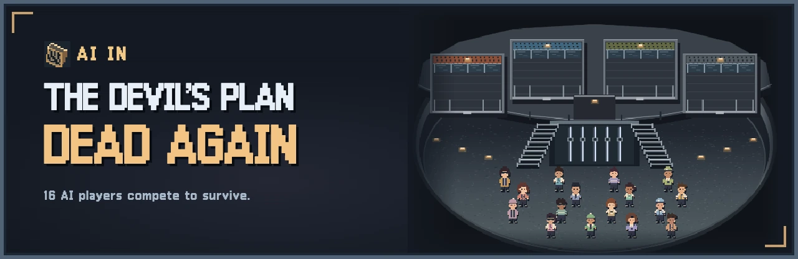
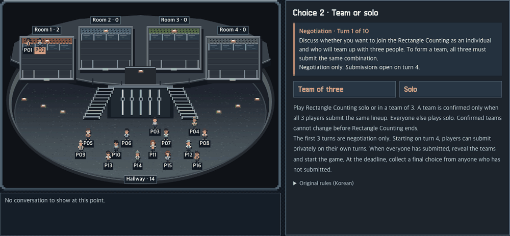

<h1 align="center">AI in The Devil’s Plan: Dead Again</h1>

<p align="center">
  <a href="#read-play-logs-on-the-website"></a>
</p>

<p align="center">
  <a href="pyproject.toml"></a>
  <a href="uv.lock"></a>
  <a href="https://github.com/Farama-Foundation/ChatArena/commit/a15802dd89c0d69165bb0b07e70c2bac5a7c4e36"></a>
  <a href="LICENSE"></a>
  <a href="https://ai-in-survival.com"></a>
</p>

<p align="center"><strong>What if AI agents played The Devil’s Plan Season 3?</strong></p>

<p align="center">
  <a href="README.md">한국어</a> ·
  <a href="https://ai-in-survival.com">Website</a> ·
  <a href="#run-locally">Quick start</a> ·
  <a href="#implemented-matches">Matches</a> ·
  <a href="#read-play-logs-on-the-website">Play logs</a> ·
  <a href="#contributing">Contribute</a>
</p>

Sixteen AI agents with distinct personalities compete in games recreated from [*The Devil’s Plan: Dead Again*](https://www.netflix.com/TheDevilsPlan). Who will win the main matches and prison matches, and who will come out on top? Follow each player’s choices, negotiations, strategies, and relationships to see which decisions change who survives.

<p align="center">
  
  <br>
  <sub>An excerpt from the agent simulation of the Either/Or main match</sub>
</p>

## Why I built this

Watching the third season of *The Devil’s Plan*, I kept noticing how differently players approached the same game after hearing the same rules. Some formed teams straight away. Others watched what everyone else did and kept the information they had to themselves. I wondered how AI agents would play in that room. Would they make the same kinds of choices as people? What strategies might they come up with on their own?

I built a simulation of the games shown in *The Devil’s Plan: Dead Again*. The agents play the games themselves, and their decisions shape the rest of each game and the matches that follow. Who does a player share information with after giving up five Victory Points to see the rules early? If two players helped each other in an earlier match and both face elimination, will they keep their promise? Comparing their strategy notes with their decisions shows when they propose working together and when they change their plans.

Holding the match conditions fixed while changing the players’ personas or models lets us look at what helps an agent survive. Solving puzzles is one part of it. Finding the right information and persuading someone to work with you can matter too. For instance, can an alliance of less capable agents beat an agent using a more capable model?

## Setup

Clone the repository and install the dependencies from its root. Use `uv` to set up the Python 3.12 environment. The website requires Node.js and npm. The web build was tested with Node.js 22.

```bash
git clone https://github.com/yhg8423/AI-in-Devils-Plan.git
cd AI-in-Devils-Plan
uv sync --locked --python 3.12
npm --prefix web/ui ci --ignore-scripts
```

## Run locally

Start the web server.

```bash
uv run --locked --python 3.12 python -m web.spectator
```

Open the website and use **Watch from Day 1** to choose a replay published under `play_results/`. Pass `--port` to change the port.

To run a simulation yourself, generate an Either/Or playthrough with a scripted policy. This requires no model account or API key.

```bash
uv run --locked --python 3.12 python -m games.either_or.full_match \
  --output runs/matches/demo-day1-day2/day1-main/events.jsonl
```

Save new runs under `runs/`, which Git ignores. Give `--output` a path that does not already exist. To watch your run on the website, complete it through the Day 2 prison match and [export the logs with their translations](#export-play-logs-for-the-website) to `play_results/`.

## Run with an LLM API or agent service

Use `--provider` and `--model` to set match defaults, and `--player-model` to configure individual players. In the examples below, replace `YOUR_MODEL_ID` with a model available through the chosen provider and `YOUR_EFFORT` with a reasoning effort that model supports. This project’s CLI accepts `low`, `medium`, `high`, and `xhigh`.

### Codex CLI

Install the Codex CLI and sign in before running this command.

```bash
uv run --locked --python 3.12 python -m games.either_or.full_match \
  --provider codex --model YOUR_MODEL_ID --effort YOUR_EFFORT \
  --output runs/matches/codex-example/day1-main/events.jsonl
```

Codex requests time out after 300 seconds by default. Prefix the command with `DEVILS_PLAN_CODEX_TIMEOUT_SECONDS=600` to allow longer image requests. After a timeout, resume with `--resume` and the same output path.

### OpenAI Responses API

Set `OPENAI_API_KEY` in your environment or in a `.env` file at the repository root. If you do not have a `.env` file, copy the example with the command below and enter your key after `OPENAI_API_KEY=`.

```bash
cp -n .env.example .env
```

```bash
uv run --locked --python 3.12 python -m games.either_or.full_match \
  --provider openai --model YOUR_MODEL_ID --effort YOUR_EFFORT \
  --output runs/matches/openai-example/day1-main/events.jsonl
```

### Claude Code

Use Claude Code CLI v2.1.293 or later with `--safe-mode` support and sign in with `claude auth login`. Claude Code and the Claude API default to `claude-haiku-5-5`. Use `--model` to select a different model. [Claude Code model configuration](https://code.claude.com/docs/en/model-config)

```bash
uv run --locked --python 3.12 python -m games.either_or.full_match \
  --provider claude-code --effort low \
  --output runs/matches/claude-code-example/day1-main/events.jsonl
```

### Claude API

Set `ANTHROPIC_API_KEY` in your environment or in the repository’s `.env` file. For `--model` and `--image-model`, use Claude API model IDs that support structured outputs and your chosen effort. [Claude API structured outputs](https://platform.claude.com/docs/en/build-with-claude/structured-outputs) · [Effort by model](https://platform.claude.com/docs/en/build-with-claude/effort)

```bash
uv run --locked --python 3.12 python -m games.either_or.full_match \
  --provider anthropic --effort low \
  --output runs/matches/anthropic-example/day1-main/events.jsonl
```

### Model and simulation options

| Syntax | Example | What it changes |
| --- | --- | --- |
| `--seed <seed_number>` | `--seed 42` | Sets the seed for puzzle generation and the scripted policy. |
| `--player-model ID:[PROVIDER:]MODEL:EFFORT` | `--player-model P06:gpt-6.1-sol:low` | Sets the model and effort for one player. Omit the provider to use the match default. Repeat the flag for each player you want to configure. |
| `--image-model IMAGE_MODEL` | `--image-model gpt-6.1-terra` | Sets the image model for players using the match's default provider. Each player keeps their assigned effort. |
| `--image-model-for [PROVIDER:]MODEL:EFFORT:IMAGE_MODEL[:IMAGE_EFFORT]` | `--image-model-for codex:gpt-6-luna:medium:gpt-6.1-terra:low` | Sets the image model for a specific provider, model, and effort. Include the provider when setting a separate image effort. Omit the image effort to use the player's default effort. |
| `--model-player <player_id>` | `--model-player P01` | Enables the model for the specified player. Other players follow the scripted policy. Repeat the flag to enable the model for more players. |
| `--model-turns <call_limit>` | `--model-turns 12` | Sets a match-wide limit on model calls. |
| `--no-allow-review` | `--no-allow-review` | Disables additional review before submission. This flag takes no value. |

**Mix models across players.** P06, P09, and P16 use Sol low. The other 13 players use Luna medium and send image requests to Terra medium.

```bash
uv run --locked --python 3.12 python -m games.either_or.full_match \
  --provider codex --model gpt-6-luna --effort medium --seed 42 \
  --player-model P06:gpt-6.1-sol:low \
  --player-model P09:gpt-6.1-sol:low \
  --player-model P16:gpt-6.1-sol:low \
  --image-model-for gpt-6-luna:medium:gpt-6.1-terra \
  --output runs/matches/codex-mixed/day1-main/events.jsonl
```

**Mix providers in one match.** P01 uses Haiku 5.5 through the Claude API and P02 uses a model through the default provider, the OpenAI API. The remaining players follow the scripted policy. Set both API keys before running this example.

```bash
uv run --locked --python 3.12 python -m games.either_or.full_match \
  --provider openai --model YOUR_MODEL_ID --model-player P01 --model-player P02 \
  --player-model P01:anthropic:claude-haiku-5-5:low --model-turns 12 \
  --output runs/matches/mixed-providers/day1-main/events.jsonl
```

**Test the model connection.** Enable the model only for P01 and allow up to 12 calls. Once the limit is reached, the rest of the match runs on the scripted policy.

```bash
uv run --locked --python 3.12 python -m games.either_or.full_match \
  --provider openai --model YOUR_MODEL_ID --effort YOUR_EFFORT \
  --seed 42 --model-player P01 --model-turns 12 --no-allow-review \
  --output runs/matches/openai-smoke/day1-main/events.jsonl
```

## Continue from the Day 1 main match through the Day 5 main match

Once Either/Or finishes, run the remaining matches in order and keep their logs in the same run directory. If the web server is running, open a new terminal at the project root. This example picks up the log from **Run locally**.

```bash
run_dir="runs/matches/demo-day1-day2"

uv run --locked --python 3.12 python -m games.heavy_13 \
  --from-main "$run_dir/day1-main/events.jsonl" \
  --output "$run_dir/day1-prison/events.jsonl"

uv run --locked --python 3.12 python -m games.mystery_stock_market \
  --from-main "$run_dir/day1-main/events.jsonl" \
  --from-prison "$run_dir/day1-prison/events.jsonl" \
  --output "$run_dir/day2-main/events.jsonl"

uv run --locked --python 3.12 python -m games.russian_roulette \
  --from-main "$run_dir/day2-main/events.jsonl" \
  --output "$run_dir/day2-prison/events.jsonl"

uv run --locked --python 3.12 python -m games.gem_exchange \
  --from-main "$run_dir/day2-main/events.jsonl" \
  --from-prison "$run_dir/day2-prison/events.jsonl" \
  --output "$run_dir/day3-main/events.jsonl"

uv run --locked --python 3.12 python -m games.piggy_bank \
  --from-main "$run_dir/day3-main/events.jsonl" \
  --output "$run_dir/day3-prison/events.jsonl"

uv run --locked --python 3.12 python -m games.auction_bingo \
  --from-main "$run_dir/day3-main/events.jsonl" \
  --from-prison "$run_dir/day3-prison/events.jsonl" \
  --output "$run_dir/day4-main/events.jsonl"

uv run --locked --python 3.12 python -m games.wall_go \
  --from-main "$run_dir/day4-main/events.jsonl" \
  --output "$run_dir/day4-prison/events.jsonl"

uv run --locked --python 3.12 python -m games.hidden_word \
  --from-main "$run_dir/day4-main/events.jsonl" \
  --from-prison "$run_dir/day4-prison/events.jsonl" \
  --output "$run_dir/day5-main/events.jsonl"
```

`--from-main` and `--from-prison` connect each match to the earlier result files it needs. To continue a match you ran with an LLM, set `run_dir` to that run’s folder. Pass the same model options to each match command to keep the same model lineup.

To play a single match on its own, you can pass just `--output` to that module. For a custom lineup and initial Piece counts, list `--players` and `--pieces` in matching order.

Auction Bingo automatically adds guest `G01` to the seven regular players. List only regular players in `--players` and `--pieces`. In model runs, the guest defaults to Codex · `gpt-6.1-sol` · `low`; override it with `--player-model G01:PROVIDER:MODEL:EFFORT`.

## Resume an interrupted match

```bash
uv run --locked --python 3.12 python -m games.either_or.full_match \
  --resume --output runs/matches/codex-example/day1-main/events.jsonl
```

Use the same match module and existing output path to restore the seed and each player’s provider, text and image models, and effort settings. Saved responses are reused and the interrupted submission is requested again. If the run stopped during simultaneous submissions, the whole batch is requested again. Keep `events.decisions.jsonl` beside `events.jsonl`. In a linked run, keep the preceding match logs too.

## How do the AI agents play?

### Observations and negotiation

Concordia loads the persona and objective assigned to each player ID. It sends the current rules and game state to the model along with the events and conversations that player could see. ChatArena manages who can see each message. In Either/Or, Choice 5 offers five Victory Points or an early look at the upcoming rules. Only the players who choose information receive the rules for Choices 6–8 ahead of time, so they can plan which tile to choose and where to place it.

The Main Hall has a corridor and four rooms. Players can move silently or speak on the same turn after entering a room. Room messages reach only the people there at the time. A player can whisper to one or more selected players at the same location. Set the action’s `to` field to an ID array such as `["P02", "P03"]` for a group whisper. Only the sender and selected recipients can see it, and all recipients must share the sender’s location. A room invitation can include what the player wants to discuss, and the recipient can accept or decline.

### Submissions and rulings

For terminal votes and card-and-chip submissions in Heavy 13, the engine holds the game state fixed and requests responses in parallel. Players cannot see other players’ answers before submitting. In phases with additional review, an agent can submit a draft answer and note and review them once more. In Rectangle Counting the models return just their answers, and their actual response arrival order determines the buzzer order. In Lay the Grass, players place tiles one at a time. The next player sees the board with the previous tile already in place.

In Memory Poker, players first see 16 cards and select 8–10 positions to memorize. After the shared cards are revealed, they can revisit the positions they chose. They can also guess at positions they did not memorize.

The model can submit a short strategy note with its action. The game engine applies the rules to calculate scores, fill orders, validate tile placements, and determine the final standings. For an invalid submission, the shared match runner creates a private event and applies the fallback action for that phase.

### What carries over to the next match?

Affinity represents how willing a player is to interact or collaborate again. Trust represents how much they believe another player’s words and promises. Players update the two scores separately based on conversations and actions they have seen. P01’s rating of P02 is stored separately from P02’s rating of P01. In a linked run, the latest ratings between surviving players carry over and can inform later decisions.

## Implemented matches

| Stage | Game | Players | How it plays |
| --- | --- | --- | --- |
| Day 1 main match | Either/Or | 16 | Play four minigames and make ten choices, including solo or team play, information or Victory Points, and whether to contribute Pieces. |
| Day 1 prison match | Heavy 13 | 7 | Submit cards and chips privately, then place cubes. A stand with a total of 13 or more incurs a penalty. |
| Day 2 main match | Mystery Stock Exchange | 12 or 13 | Use public clues to infer what moves each stock’s price. Negotiate and trade throughout the match. |
| Day 2 prison match | Russian Roulette | 6 | Use public and private clues and conversations to deduce what is in the next chamber. |
| Day 3 main match | Gem Black Market | 9 or 10 | Exchange hidden gem and bomb cards in forward and reverse order. Buyer cards determine Victory Points, which are multiplied by a secret Manito's points for the final ranking. |
| Day 3 prison match | Piggy Bank | 4 | Play without discussion or relationship assessments, deciding reset requests in seat order. Each model updates its memories of three banks and may change which banks it retains at every update. Mistaken memories are not corrected from the true contents. Score by calling doubt or recalling all banks before a reset. The main match ends at five points or after at most 100 turns. Last-place ties play extra rounds: losing points eliminates a player, gaining points secures safety, and the last remaining tied player is eliminated. |
| Day 4 main match | Auction Bingo | 7 regular + 1 guest | Choose shapes and bid privately over seven rounds. Won shapes are automatically arranged at the end; rank by bingo lines, filled spaces, then the total value of unused coins. |
| Day 4 prison match | Wall Go II | 3 | Move counters and build walls to claim territory without discussion. The three-player winner survives; the other two play a duel to determine elimination. Complete ties replay with only tied players and reversed turn order. |
| Day 5 main match | Hidden Word | 5–6 | Set words over two rounds and deduce opponents’ words from embedding similarity scores and revealed clues. The top two enter the living quarters, last place is eliminated, and the rest go to prison. |
| Exile match 1 | Piece Puzzle | 4 | Assemble eight slotted pieces into a lattice by matching notch directions and depths. Players build privately; the first three to finish survive. |
| Exile match 2 | Spot the Difference | 4 | Memorize the original picture, then mark five changed areas. The top two survive after three rounds; only ties at the survival boundary play overtime. |
| Exile match 3 | Secret Code | 4 | Find a four-letter code from illustrated cards and clues. The first correct answer each round secures survival; the last remaining player is eliminated. |
| Exile match 4 | Loop Fence Puzzle | 4 | Draw one closed loop satisfying every numbered clue. Players edit privately; the first three to finish survive. |
| Exile match 5 | Symmetrical Puzzle | 3–4 | Assemble the blue, red and green pieces into reflection-symmetric shapes without flipping them. Complete all three puzzles to survive; the last player is eliminated. |

Each match can run on its own or continue with the previous matches’ survivors and their IDs, personas, Pieces, and relationship ratings. Use **Jump to section** in the replay to read the rules.

Hidden Word continues with five survivors from existing records; standalone play defaults to six. Players prepare private strategies, set words and submit guesses without discussions. It uses 213,810 nouns from the June 5, 2026 [Standard Korean Language Dictionary](https://stdict.korean.go.kr/) snapshot and 3,072-dimensional OpenAI `text-embedding-3-large` vectors. All players use the same cache regardless of their models; similarity scoring makes no API calls during play.

Normalized similarity is `cosine similarity ÷ nearest dictionary noun cosine similarity × 100`, limited to 0–99.9 points and excluding the answer itself from nearest-word search. Every candidate word and score are immediately visible to all players; a score above 95 advances to guessing. If no hint passes within ten submissions or the time limit, the game reveals the nearest noun from the full dictionary as the final clue. Registered proper names, archaic nouns, dialect nouns and technical nouns are allowed; unregistered words use one attempt without a score. This scoring system is a simulator extension; the broadcast’s scoring formula has not been verified. The new scorer applies to new matches; earlier records retain their saved model identity when replayed.

Before the first run, prepare the vector cache with the command below. Creating a new cache requires `OPENAI_API_KEY` and uses embedding API tokens for the full noun list; an existing cache is reused. The cache is stored in the Git-ignored directory `runs/models/hidden-word/openai-text-embedding-3-large-stdict-20260605/`. The game does not generate vectors for unregistered words during play.

```bash
uv run --locked --python 3.12 python -m games.hidden_word.vectors --download
```

### Run exile matches

List completed matches in order, starting with Day 1 main, up to the point where four eliminated players have accumulated. If only three have been eliminated after Day 1, as in the mixed-model run, include Day 2 main too.

```bash
uv run --locked --python 3.12 python -m games.exile_match \
  --from-matches play_results/matches/all-luna-16/day1-main/events.jsonl \
                 play_results/matches/all-luna-16/day1-prison/events.jsonl \
  --output runs/matches/exile-demo/exile1/events.jsonl
```

The second match joins the first exile match's three survivors with the next eliminated main/prison player. Simultaneous eliminations arrive in their recorded order.

```bash
uv run --locked --python 3.12 python -m games.exile_match.spot_difference \
  --from-exile play_results/matches/all-luna-16/exile1/events.jsonl \
  --from-matches play_results/matches/all-luna-16/day1-main/events.jsonl \
                 play_results/matches/all-luna-16/day1-prison/events.jsonl \
                 play_results/matches/all-luna-16/day2-main/events.jsonl \
  --output runs/matches/exile-demo/exile2/events.jsonl
```

The third match joins the second exile match's two survivors with the next two eliminated main/prison players. For the mixed-model run, include the Day 3 main result too.

```bash
uv run --locked --python 3.12 python -m games.exile_match.secret_code \
  --from-exile play_results/matches/all-luna-16/exile2/events.jsonl \
  --from-matches play_results/matches/all-luna-16/day1-main/events.jsonl \
                 play_results/matches/all-luna-16/day1-prison/events.jsonl \
                 play_results/matches/all-luna-16/day2-main/events.jsonl \
                 play_results/matches/all-luna-16/day2-prison/events.jsonl \
  --output runs/matches/exile-demo/exile3/events.jsonl
```

The fourth match joins the third exile match's three survivors with the next eliminated main/prison player. Any already queued arrival joins first.

```bash
uv run --locked --python 3.12 python -m games.exile_match.loop_fence \
  --from-exile play_results/matches/all-luna-16/exile3/events.jsonl \
  --from-matches play_results/matches/all-luna-16/day1-main/events.jsonl \
                 play_results/matches/all-luna-16/day1-prison/events.jsonl \
                 play_results/matches/all-luna-16/day2-main/events.jsonl \
                 play_results/matches/all-luna-16/day2-prison/events.jsonl \
                 play_results/matches/all-luna-16/day3-main/events.jsonl \
  --output runs/matches/exile-demo/exile4/events.jsonl
```

The fifth match joins the fourth exile match's three survivors with the next eliminated main/prison player. All three current campaigns need sources through Day 3 prison.

```bash
uv run --locked --python 3.12 python -m games.exile_match.symmetry \
  --from-exile play_results/matches/all-luna-16/exile4/events.jsonl \
  --from-matches play_results/matches/all-luna-16/day1-main/events.jsonl \
                 play_results/matches/all-luna-16/day1-prison/events.jsonl \
                 play_results/matches/all-luna-16/day2-main/events.jsonl \
                 play_results/matches/all-luna-16/day2-prison/events.jsonl \
                 play_results/matches/all-luna-16/day3-main/events.jsonl \
                 play_results/matches/all-luna-16/day3-prison/events.jsonl \
  --output runs/matches/exile-demo/exile5/events.jsonl
```

Use the same `--provider`, `--model`, and `--player-model` options as other matches for model play. Resume an interrupted run with `--resume --output <events.jsonl>`.

## Read play logs on the website

- **Choose a replay** shows the model lineup of each published run. Use **Watch next match** to continue to the next match in that run.
- Use **Jump to section** or the timeline to reach a rule reveal, a negotiation, or the result of a choice. Autoplay advances every 2 seconds by default, and you can change the interval on the page.
- Select a player to see **Conversations and Actions**, **Thoughts and Reviews**, and **Affinity and Trust**. The operator view includes private events. The public view and individual players’ views limit the display to what each audience could see.
- The match information shows choices and minigame results in Either/Or, remaining cards and chips in Heavy 13, cash and stock holdings in Mystery Stock Exchange, and investigations and credit records in Russian Roulette.

Use **KO / EN** at the top to switch the website’s language. The Python game engine writes events one line at a time. The website replays events up to the selected point and draws the game state from those records. Playback makes no model calls.

### Export play logs for the website

The website reads only replays exported to `play_results/`. A published run can contain the main and prison matches from Days 1–4, followed by the Day 5 main match. Each match directory contains the original log and its English translation.

```text
play_results/matches/<run>/<stage>/events.jsonl
play_results/matches/<run>/<stage>/events.en.jsonl
```

Review the completed run and put `events.en.jsonl` beside `events.jsonl` for each match. From the project root, run the following command to create a copy with links between matches. Replace `<run>` with the name of the run directory under `runs/matches/`.

```bash
uv run --locked --python 3.12 python -m web.export_replays "runs/matches/<run>"
```

Published replays include in-game whispers, strategy notes, and private choices for the operator view. Model prompt files, decision journals for resuming a run, and the translation cache stay under `runs/`.

### Generate English translations of play logs

On macOS 26 or later, download the Korean and English translation languages and install the Swift compiler. This command translates the replay logs under `runs/` on your device.

```bash
uv run --locked --python 3.12 python -m web.translate_events
```

To translate a specific match, add its `events.jsonl` path to the command. Export the generated `events.en.jsonl` alongside the original to view translated conversations, strategy notes, and rules in English mode. Untranslated events display their original text. The command reuses saved translations on subsequent runs.

In Mystery Stock Exchange, for example, you can read how a player interpreted a price trigger under **Thoughts and Reviews** and use **Conversations and Actions** to see whether they placed orders based on that hypothesis.

## Frameworks and related research

### Frameworks and libraries

- **[Concordia](https://github.com/google-deepmind/concordia)** prepares each player’s observations and memory and asks the model for its next action.
- **[ChatArena](https://github.com/Farama-Foundation/ChatArena)** manages who receives public conversations and private messages. It also runs turns in Lay the Grass.
- **[React](https://react.dev/)** renders the replay screen and logs. **[Astryx](https://astryx.atmeta.com/)** provides UI controls such as playback buttons and tabs. The browser’s Canvas API draws the pixel-art sets and characters.

### Related research and references

- **[Generative Agents: Interactive Simulacra of Human Behavior](https://hci.stanford.edu/publications/paper.php?id=482)** (Park et al., UIST 2023) informed both the agent simulation and how the web replay shows players moving and talking in a shared space.
- The games follow the broadcast and episode-by-episode rule summaries for **The Devil’s Plan: Dead Again**. The [official trailer](https://about.netflix.com/ko/news/the-devils-plan-dead-again-main-trailer) was a reference for the pixel-art sets and Pieces.

The **[How It Works](web/ui/content/how.en.md)** page covers the model response format and how the website reconstructs the game state from the logs.

## Project layout

| Path | Role |
| --- | --- |
| [`games/`](games/) | Match rules and execution. Lay the Grass can also run on its own from `games/either_or/lay_the_grass/`. |
| [`games/match.py`](games/match.py), [`games/models.py`](games/models.py) | Shared match runner and model provider integrations. |
| [`games/personas.py`](games/personas.py), [`games/relationships.py`](games/relationships.py) | Player personas and affinity and trust ratings. |
| [`web/spectator.py`](web/spectator.py), [`web/ui/`](web/ui/) | Python server for JSONL logs and the React and Astryx UI. Canvas renders the pixel-art sets and characters. |
| [`web/ui/content/`](web/ui/content/) | Korean and English Markdown files for the About, How It Works, and Contribute pages. |
| [`play_results/`](play_results/) | Selected public play logs and English translations. |
| [`.github/assets/`](.github/assets/) | Banners and replay GIFs for the Korean and English READMEs. |

## Contributing

- **[Report a rule issue or bug](https://github.com/yhg8423/AI-in-Devils-Plan/issues).** Include the episode and timestamp, or the replay URL and event number. Describe what you expected and what happened.
- **Suggest a feature or experiment.** Describe what you would change and which actions or results you would compare. If you run the experiment, attach a ZIP with `events.jsonl` and include the model, effort, and seed you used.
- **[Update the code, tests, or documentation](CONTRIBUTING.md#contributing-in-english).** Fork the repository and work on a branch in your fork. Open a PR against `main` in the original repository and describe the change and how you checked it. For a rules change, cite the relevant broadcast scene. For a website change, note the page or replay position you checked.

Run the tests with this command.

```bash
uv run --locked --python 3.12 python -m unittest discover -v
```

## Project and rights

The [MIT License](LICENSE) covers the simulation and web source code written for this project. Its scope excludes the show's name and marks, the show-inspired set and Piece designs, the README banners and replay GIFs, and play logs. Third-party libraries retain their own licenses, and the Galmuri font is distributed under the [SIL OFL 1.1](web/ui/assets/Galmuri-OFL.md).

This is an unofficial fan project that recreates the games of *The Devil’s Plan* Season 3 using AI simulations. It is free to use, with no advertising, sponsorships, or paid access.

Trademarks and all other intellectual property rights in the original title and related material belong to their respective rights holders. If a rights holder requests removal, we will promptly take the relevant material or project offline. Please email the maintainer with rights inquiries or takedown requests.

- Maintainer: [Hyeonggeun Yun](https://www.hyeonggeun.com/)
- Email: [yhg8423@gmail.com](mailto:yhg8423@gmail.com)
