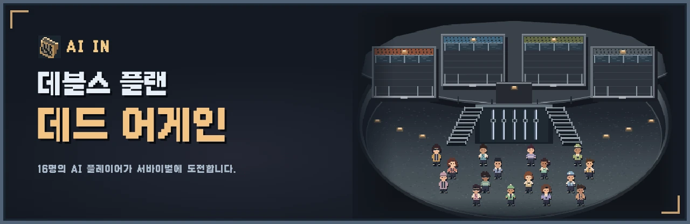
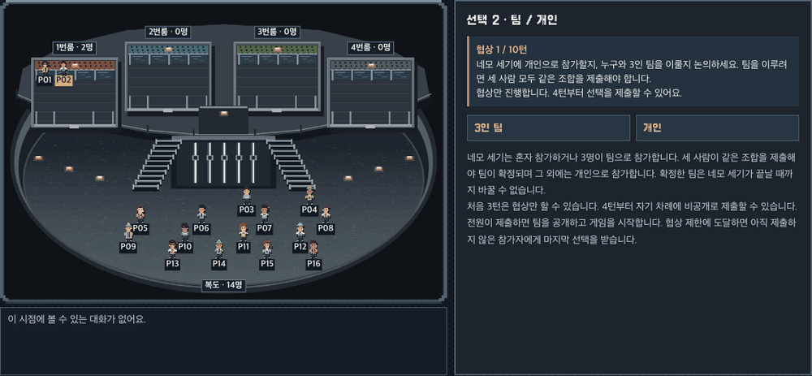

<h1 align="center">AI in 데블스 플랜: 데드 어게인</h1>

<p align="center">
  <a href="#웹에서-플레이-기록-보기"></a>
</p>

<p align="center">
  <a href="pyproject.toml"></a>
  <a href="uv.lock"></a>
  <a href="https://github.com/Farama-Foundation/ChatArena/commit/a15802dd89c0d69165bb0b07e70c2bac5a7c4e36"></a>
  <a href="LICENSE"></a>
  <a href="https://ai-in-survival.com"></a>
</p>

<p align="center"><strong>AI 에이전트가 데블스 플랜 시즌 3에 참가한다면 어떻게 될까요?</strong></p>

<p align="center">
  <a href="README.en.md">English</a> ·
  <a href="https://ai-in-survival.com">웹사이트</a> ·
  <a href="#로컬에서-시작하기">빠른 시작</a> ·
  <a href="#현재까지-구현한-매치-목록">구현한 매치</a> ·
  <a href="#웹에서-플레이-기록-보기">플레이 기록</a> ·
  <a href="#기여하기">기여하기</a>
</p>

서로 다른 성향을 가진 16명의 AI 에이전트 참가자가 <[데블스 플랜: 데드 어게인](https://www.netflix.com/TheDevilsPlan)>을 재현한 게임에 도전합니다. 어떤 참가자가 메인 매치와 감옥 매치에서 승리를 거두고, 최종 우승을 차지할 수 있을까요? 이 프로젝트에서 각 참가자의 선택, 협상 과정, 전략, 다른 플레이어와의 관계를 살펴보고, 어떤 선택이 그들의 운명을 바꿨는지 살펴보세요.

<p align="center">
  
  <br>
  <sub>양자택일 메인 매치에서의 에이전트 시뮬레이션 일부</sub>
</p>

## 프로젝트 목적

데블스 플랜의 세 번째 시즌이 공개됐습니다. 데블스 플랜과 같은 두뇌 서바이벌 게임 프로그램을 보면, 같은 규칙과 설명을 듣고도 플레이어마다 전략과 행동이 달라지는 모습이 흥미로웠습니다. 바로 팀을 꾸리는 사람이 있는가 하면 다른 참가자들의 움직임을 지켜보며 자기가 아는 정보를 아끼는 사람도 있습니다. 그 게임에 사람 대신 AI 에이전트가 있으면, 과연 AI 에이전트도 다른 사람 플레이어처럼 행동을 할 지, 아니면 AI 에이전트만의 색다른 플레이를 보여줄지 궁금했습니다.

그래서 <데블스 플랜: 데드 어게인>의 공개된 게임을 바탕으로 AI 에이전트들이 직접 게임에 참가하여 플레이한 결과가 다음 판세와 매치에 이어져, 데블스 플랜과 동일한 시스템으로 서바이벌 게임을 진행하는 시뮬레이션을 만들었습니다. 예를 들어 승점 5점을 포기하고 규칙을 미리 본 참가자는 그 정보를 누구와 나눌까요? 앞 매치에서 서로 도왔던 두 참가자가 같은 탈락 후보에 놓이면 이전의 약속을 지킬까요? 각자의 전략 메모와 실제 선택을 함께 보면 에이전트가 어떤 상황에서 협력을 제안하고 언제 계획을 바꿨는지 확인할 수 있습니다.

단순히 AI 에이전트의 선택 뿐만이 아니라, 같은 조건에서 참가자의 페르소나나 모델의 성능을 바꿔 보면서 퍼즐을 잘 푸는 능력과 필요한 정보를 얻거나 협력 상대를 설득하는 능력, 성능이 낮은 에이전트들의 연합이 성능이 높은 에이전트를 상대로 승리할 수 있는지 등, AI 에이전트의 설계 방식이 생존에 어떤 영향을 주는지도 살펴보고자 합니다.

## 세팅하기

저장소를 내려받은 뒤 프로젝트 루트에서 의존성을 설치합니다. Python 3.12 환경은 `uv`로 준비합니다. 웹을 실행하려면 Node.js와 npm이 필요합니다. 웹 빌드는 Node.js 22에서 확인했습니다.

```bash
git clone https://github.com/yhg8423/AI-in-Devils-Plan.git
cd AI-in-Devils-Plan
uv sync --locked --python 3.12
npm --prefix web/ui ci --ignore-scripts
```

## 로컬에서 시작하기

웹 서버를 시작합니다.

```bash
uv run --locked --python 3.12 python -m web.spectator
```

브라우저에서 웹을 열고 **1일차부터 보기**에서 `play_results/`에 공개된 기록을 고릅니다. 포트를 바꾸려면 `--port`를 지정합니다.

시뮬레이션을 직접 실행하려면 다음 명령으로 양자택일 한 판을 생성합니다. 스크립트 정책을 사용하므로 모델 계정이나 API 키가 필요 없습니다.

```bash
uv run --locked --python 3.12 python -m games.either_or.full_match \
  --output runs/matches/demo-day1-day2/day1-main/events.jsonl
```

새 결과는 Git에서 제외하는 `runs/` 아래에 저장합니다. `--output`에는 아직 사용하지 않은 경로를 지정합니다. 웹에서 재생하려면 2일차 감옥 매치까지 실행한 뒤 번역본과 함께 `play_results/`로 [내보냅니다](#웹-공개용-플레이-기록-내보내기).

## LLM API 또는 에이전트 서비스로 실행하기

`--provider`와 `--model`은 매치의 기본 제공자와 모델을 지정합니다. `--player-model`로 참가자별 설정을 바꿀 수 있습니다. 아래 예시에서 `YOUR_MODEL_ID`는 선택한 서비스에서 사용할 수 있는 모델 ID로, `YOUR_EFFORT`는 그 모델이 지원하는 추론 수준으로 바꿉니다. 이 프로젝트의 CLI는 `low`, `medium`, `high`, `xhigh`를 받습니다.

### Codex CLI

Codex CLI를 설치하고 로그인한 상태에서 실행합니다.

```bash
uv run --locked --python 3.12 python -m games.either_or.full_match \
  --provider codex --model YOUR_MODEL_ID --effort YOUR_EFFORT \
  --output runs/matches/codex-example/day1-main/events.jsonl
```

### OpenAI Responses API

`OPENAI_API_KEY`를 환경 변수나 프로젝트 루트의 `.env`에 설정합니다. `.env`가 없다면 아래 명령으로 예시 파일을 복사한 뒤 `OPENAI_API_KEY=`에 키를 입력합니다.

```bash
cp -n .env.example .env
```

```bash
uv run --locked --python 3.12 python -m games.either_or.full_match \
  --provider openai --model YOUR_MODEL_ID --effort YOUR_EFFORT \
  --output runs/matches/openai-example/day1-main/events.jsonl
```

### Claude Code

Claude Code CLI v2.1.293 이상에서 `--safe-mode` 지원을 확인하고 `claude auth login`으로 로그인합니다. Claude Code와 Claude API는 기본으로 `claude-haiku-5-5`를 사용합니다. `--model`로 다른 모델을 지정할 수 있습니다. [Claude Code 모델 문서](https://code.claude.com/docs/en/model-config)

```bash
uv run --locked --python 3.12 python -m games.either_or.full_match \
  --provider claude-code --effort low \
  --output runs/matches/claude-code-example/day1-main/events.jsonl
```

### Claude API

`ANTHROPIC_API_KEY`를 환경 변수나 프로젝트 루트의 `.env`에 설정합니다. `--model`과 `--image-model`에는 구조화된 출력과 지정한 effort를 지원하는 Claude API 모델 ID를 사용합니다. [Claude API 구조화된 출력](https://platform.claude.com/docs/en/build-with-claude/structured-outputs) · [모델별 effort](https://platform.claude.com/docs/en/build-with-claude/effort)

```bash
uv run --locked --python 3.12 python -m games.either_or.full_match \
  --provider anthropic --effort low \
  --output runs/matches/anthropic-example/day1-main/events.jsonl
```

### 모델과 시뮬레이션 옵션

| 입력 형식 | 예시 | 적용되는 설정 |
| --- | --- | --- |
| `--seed <seed_number>` | `--seed 42` | 퍼즐 생성과 스크립트 정책의 시드를 지정합니다. |
| `--player-model ID:[PROVIDER:]MODEL:EFFORT` | `--player-model P06:gpt-6.1-sol:low` | 참가자별로 모델과 effort를 지정합니다. 제공자를 생략하면 매치의 기본 제공자를 사용합니다. 여러 명을 바꾸려면 참가자마다 한 번씩 붙입니다. |
| `--image-model IMAGE_MODEL` | `--image-model gpt-6.1-terra` | 매치의 기본 제공자를 쓰는 참가자의 이미지용 모델을 지정합니다. 각 참가자의 effort를 그대로 사용합니다. |
| `--image-model-for [PROVIDER:]MODEL:EFFORT:IMAGE_MODEL[:IMAGE_EFFORT]` | `--image-model-for codex:gpt-6-luna:medium:gpt-6.1-terra:low` | 제공자, 모델, effort 조합별 이미지 모델을 지정합니다. 이미지 effort를 따로 지정하려면 제공자도 써야 합니다. 이미지 effort를 생략하면 참가자의 기본 effort를 사용합니다. |
| `--model-player <player_id>` | `--model-player P01` | 지정한 참가자만 모델을 사용하고 나머지는 스크립트 정책을 따릅니다. 여러 명을 지정하려면 참가자마다 한 번씩 붙입니다. |
| `--model-turns <call_limit>` | `--model-turns 12` | 매치 전체에서 공유하는 모델 호출 한도를 지정합니다. |
| `--no-allow-review` | `--no-allow-review` | 제출 전 추가 검토를 끕니다. 값 없이 붙이는 옵션입니다. |

**참가자별 모델을 섞어서 실행하기.** P06·P09·P16은 Sol low, 나머지 13명은 Luna medium으로 플레이합니다. Luna 참가자의 이미지 요청에는 Terra medium을 씁니다.

```bash
uv run --locked --python 3.12 python -m games.either_or.full_match \
  --provider codex --model gpt-6-luna --effort medium --seed 42 \
  --player-model P06:gpt-6.1-sol:low \
  --player-model P09:gpt-6.1-sol:low \
  --player-model P16:gpt-6.1-sol:low \
  --image-model-for gpt-6-luna:medium:gpt-6.1-terra \
  --output runs/matches/codex-mixed/day1-main/events.jsonl
```

**한 매치에서 제공자를 섞어 쓰기.** P01은 Claude API의 Haiku 5.5를, P02는 기본 제공자인 OpenAI API의 모델을 사용합니다. 나머지 참가자는 스크립트로 플레이합니다. 두 API 키를 설정한 뒤 실행합니다.

```bash
uv run --locked --python 3.12 python -m games.either_or.full_match \
  --provider openai --model YOUR_MODEL_ID --model-player P01 --model-player P02 \
  --player-model P01:anthropic:claude-haiku-5-5:low --model-turns 12 \
  --output runs/matches/mixed-providers/day1-main/events.jsonl
```

**모델 연결을 짧게 점검하기.** P01에게만 모델을 연결해 최대 12회 호출합니다. 한도에 도달하면 남은 행동은 스크립트 정책으로 진행합니다.

```bash
uv run --locked --python 3.12 python -m games.either_or.full_match \
  --provider openai --model YOUR_MODEL_ID --effort YOUR_EFFORT \
  --seed 42 --model-player P01 --model-turns 12 --no-allow-review \
  --output runs/matches/openai-smoke/day1-main/events.jsonl
```

## 1일차 메인 매치에서 3일차 메인 매치까지 이어서 실행하기

양자택일이 끝난 뒤 같은 실행 폴더에 나머지 매치를 순서대로 기록합니다. 웹 서버가 켜져 있다면 새 터미널을 열고 프로젝트 루트에서 실행하세요. 아래 예시는 **로컬에서 시작하기**에서 생성한 기록을 이어갑니다.

```bash
run_dir="runs/matches/demo-day1-day2"

uv run --locked --python 3.12 python -m games.heavy_13 \
  --from-main "$run_dir/day1-main/events.jsonl" \
  --output "$run_dir/day1-prison/events.jsonl"

uv run --locked --python 3.12 python -m games.mystery_stock_market \
  --from-main "$run_dir/day1-main/events.jsonl" \
  --from-prison "$run_dir/day1-prison/events.jsonl" \
  --output "$run_dir/day2-main/events.jsonl"

uv run --locked --python 3.12 python -m games.russian_roulette \
  --from-main "$run_dir/day2-main/events.jsonl" \
  --output "$run_dir/day2-prison/events.jsonl"

uv run --locked --python 3.12 python -m games.gem_exchange \
  --from-main "$run_dir/day2-main/events.jsonl" \
  --from-prison "$run_dir/day2-prison/events.jsonl" \
  --output "$run_dir/day3-main/events.jsonl"
```

`--from-main`과 `--from-prison`이 앞 매치의 결과 파일을 연결합니다. LLM으로 실행한 매치에서 이어간다면 `run_dir`를 해당 실행 폴더로 바꿉니다. 같은 모델 구성을 사용하려면 각 매치 명령에 모델 옵션을 다시 지정합니다.

매치 하나만 따로 돌릴 때는 해당 모듈에 `--output`만 지정할 수 있습니다. 자체 명단과 시작 피스를 쓰려면 `--players`와 `--pieces`를 같은 순서로 넘깁니다.

## 중단 시점부터 재개하기

```bash
uv run --locked --python 3.12 python -m games.either_or.full_match \
  --resume --output runs/matches/codex-example/day1-main/events.jsonl
```

같은 매치 모듈과 기존 출력 경로를 지정하면 시드와 참가자별 제공자, 텍스트·이미지 모델 및 effort를 복원합니다. 저장된 응답은 재사용하고 중단된 제출만 다시 요청합니다. 동시 제출 도중에 중단되면 해당 제출 묶음 전체를 다시 요청합니다. `events.jsonl`과 같은 폴더의 `events.decisions.jsonl`을 함께 보관하세요. 연속 실행이었다면 앞 매치 로그도 필요합니다.

## AI 에이전트는 어떻게 플레이하나요?

### 관측과 협상

Concordia는 참가자 ID에 해당하는 페르소나와 목표를 불러옵니다. 현재 규칙과 판세에 그 참가자가 볼 수 있었던 사건과 대화를 붙여 모델에 전달합니다. ChatArena는 참가자별 메시지 공개 범위를 관리합니다. 양자택일 선택 5에서는 승점 5점을 받거나 다음 선택들의 규칙을 미리 볼 수 있습니다. 정보를 고른 참가자만 선택 6~8의 규칙을 미리 받고 타일과 배치 전략을 검토합니다.

메인홀에는 복도와 룸 네 곳이 있습니다. 참가자는 발언 없이 이동하거나 룸으로 이동한 뒤 같은 턴에 발언할 수 있습니다. 룸 발언은 발언 당시 그곳에 있던 사람들에게만 전달됩니다. 귓속말은 같은 장소에 있는 한 사람에게만 보낼 수 있습니다. 다른 참가자에게 안건을 적어 룸에 초대하면 상대는 수락하거나 거절할 수 있습니다.

### 제출과 판정

단말기 투표나 무거운 13의 카드·칩 제출은 판세를 고정하고 병렬로 요청합니다. 각 참가자는 자기 답을 내기 전에 다른 참가자의 답을 볼 수 없습니다. 추가 검토를 지원하는 단계에서는 임시 답안과 메모를 낸 뒤 한 번 더 검토할 수 있습니다. 네모 세기에서는 모델이 답만 제출하고 실제 응답 도착 순서가 버저 순서를 정합니다. 잔디 깔기에서는 한 명씩 타일을 배치합니다. 앞사람의 타일이 놓인 판을 다음 참가자가 받습니다.

양자택일의 기억 포커에서는 카드 16장을 먼저 보여 주고 참가자가 외울 위치를 8~10개 고르게 합니다. 공유 카드가 공개된 뒤에는 자신이 고른 위치의 카드가 다시 주어집니다. 외우지 않은 위치의 카드도 추측해서 제출할 수 있습니다.

모델은 행동과 함께 짧은 전략 메모를 제출할 수 있습니다. 점수, 주문 체결, 타일 배치의 유효성, 최종 순위는 게임 엔진이 규칙에 따라 판정합니다. 공통 실행기가 유효하지 않은 제출을 받으면 그 내용을 비공개 이벤트로 기록하고 단계에 정해 둔 대체 행동을 적용합니다.

### 다음 매치에 남는 정보

친밀도는 다시 교류하거나 협력할 의향을, 신뢰도는 상대의 말과 약속을 믿을 정도를 나타냅니다. 참가자는 자신이 본 대화와 행동을 근거로 두 점수를 따로 갱신합니다. P01이 P02에게 매긴 점수와 P02가 P01에게 매긴 점수는 각각 저장됩니다. 연속 실행에서는 생존자 사이에 저장된 최신 평가를 이어받고 이후 판단에도 참고할 수 있습니다.

보석 암시장에서는 협상 구간 종료, 경매 결과 공개, 유료 카드 확인, 교환 완료, 전체 카드·최종 점수 공개, 연맹의 징표 사용 직후에 관계 평가를 검토합니다. 교환 직후에는 자신이 확인한 카드와 공개 행동을 근거로 삼고, 라운드 끝에는 전체 공개 결과를 반영합니다. 최근 관측도 함께 참고해 이전 약속과 새 결과를 비교하며, 새 근거가 생긴 참가자만 평가 요청을 받습니다. 평가와 근거는 본인에게만 보이고 다음 판단에 반영됩니다.

## 현재까지 구현한 매치 목록

| 구분 | 게임 | 인원 | 진행 방식 |
| --- | --- | --- | --- |
| 1일차 메인 매치 | 양자택일 | 16명 | 네 가지 미니게임을 치르며 개인·팀 참가, 정보와 승점, 피스 모금 등을 포함해 열 가지 선택에 답합니다. |
| 1일차 감옥 매치 | 무거운 13 | 7명 | 카드와 칩을 비공개로 제출하고 큐브를 배치합니다. 받침대의 합이 13 이상이 되면 벌점을 받습니다. |
| 2일차 메인 매치 | 미스터리 거래소 | 12명 또는 13명 | 공개 단서로 종목의 시세 변동 조건을 추리하고 협상과 매수·매도를 함께 진행합니다. |
| 2일차 감옥 매치 | 러시안 룰렛 | 6명 | 공개·비공개로 얻은 단서와 대화를 바탕으로 다음 칸을 추리합니다. |
| 3일차 메인 매치 | 보석 암시장 | 9명 또는 10명 | 숨겨진 보석·폭탄 카드를 정순·역순으로 교환합니다. 구매자 카드로 승점을 얻고 마니또의 승점을 곱해 최종 순위를 정합니다. |

매치를 따로 실행할 수 있으며, 연속 실행에서는 감옥동에 배정된 참가자가 해당 감옥 매치로 이동합니다. 다음 날 메인 매치는 전날 두 매치의 생존자로 시작합니다. 양자택일의 피스 모금 성립 여부에 따라 2일차에는 13명 또는 12명, 3일차에는 10명 또는 9명이 진출합니다. 참가자의 ID, 페르소나, 보유 피스와 저장된 관계 평가도 다음 매치에 이어집니다. 매치 규칙은 재생 화면의 **구간 이동**에서 확인할 수 있습니다.

보석 암시장은 [방송 규칙 정리](https://namu.wiki/w/데블스%20플랜:%20데드%20어게인/3일차)를 바탕으로 9인·13장·3라운드로 구현했습니다. 10인이 진출한 경로에서는 동 1점 카드 한 장을 추가합니다. 규칙 공개 뒤 마니또를 모르는 상태에서 참가자마다 12턴씩 협상 행동을 합니다. 다음 단계에서 각자 마니또를 비공개로 안내받고, 중간 대화 없이 선 경매 입찰액을 동시에 비공개로 제출합니다. 경매가 끝나면 참가자마다 최대 5턴씩 추가 대화를 진행한 뒤 카드를 배분합니다. 각 교환 전 대화와 경매 동률 협상도 참가자마다 최대 5턴씩 진행하며, 한 회전에서 전원이 패스하면 일찍 끝납니다. 경매가 동률이면 전원이 재입찰이나 선 지명을 논의하고, 동률자들만 재입찰하거나 최종 지명 투표를 합니다. 교환 전 대화 중에는 피스를 써서 구매자·휴지통 카드를 확인할 수도 있습니다. 교환자는 대화와 유료 확인 여부 결정을 마친 뒤 비공개 전략 메모를 한 번 정리하고, 그 메모를 참고해 교환 대상을 결정합니다. 피스 경매 합의 불발과 최종 동점은 추첨한 기본 순서로 판정합니다. 마니또 관계는 무작위로 섞은 참가자들을 한 방향의 고리로 연결해 결정합니다. 이 항목들은 시뮬레이터의 확장·진행 규칙입니다. 이전 버전에서 중단된 매치는 저장된 규칙에 따라 당시의 대화·교환 순서로 재개합니다.

9~10명 전원을 모델로 실행하며 긴 협상까지 진행하려면 매치 명령에 `--model-turns 4000`처럼 호출 예산을 지정하세요. 대화·관계 평가·전략 정리·교환 결정이 모두 이 예산을 사용하며, 한도에 도달하면 스크립트 정책으로 이어집니다.

## 웹에서 플레이 기록 보기

- **플레이 기록 선택**에서 공개된 기록의 모델 구성을 확인할 수 있습니다. **다음 매치 보기**로 같은 실행의 다음 매치로 이동합니다.
- **구간 이동**이나 타임라인으로 규칙 공개, 협상, 선택 결과 등 보고 싶은 장면으로 이동합니다. 자동 재생 간격은 기본 2초이며 화면에서 조절할 수 있습니다.
- **참가자 선택**으로 `대화와 행동`, `생각과 검토`, `친밀도·신뢰도`를 확인합니다. 운영자 시점은 비공개 이벤트까지 표시합니다. 공개 및 참가자 시점은 해당 시점에 보이는 범위로 화면을 좁힙니다.
- **매치별 정보**에서 양자택일의 선택과 미니게임 결과, 무거운 13의 남은 카드·칩, 미스터리 거래소의 현금·주식 보유량, 러시안 룰렛의 조사와 크레딧 기록을 확인합니다.

상단 **KO / EN**으로 웹 언어를 바꿀 수 있습니다. Python 게임 엔진은 이벤트를 줄 단위로 저장합니다. 웹은 선택한 재생 위치까지의 이벤트를 적용해 그때의 판세를 다시 그립니다. 이 과정에서 모델 호출은 발생하지 않습니다.

### 웹 공개용 플레이 기록 내보내기

웹은 `play_results/`에 내보낸 기록만 읽습니다. 공개용 실행 하나에는 1일차와 2일차의 메인·감옥 매치 네 개와, 플레이한 경우 3일차 메인 매치가 들어갑니다. 각 매치의 원본과 영어 번역은 다음 경로에 저장합니다.

```text
play_results/matches/<run>/<stage>/events.jsonl
play_results/matches/<run>/<stage>/events.en.jsonl
```

공개할 실행을 검토하고, 각 매치의 `events.jsonl` 옆에 `events.en.jsonl`을 준비합니다. 프로젝트 루트에서 아래 명령을 실행하면 매치 간 연결 경로를 포함한 공개용 사본을 만듭니다. `<run>`은 `runs/matches/` 아래의 실행 폴더 이름으로 바꿉니다.

```bash
uv run --locked --python 3.12 python -m web.export_replays "runs/matches/<run>"
```

공개 기록에는 운영자 시점에서 볼 수 있는 게임 내 귓속말, 전략 메모, 비공개 선택도 들어갑니다. 모델 프롬프트 파일, 재개용 결정 기록, 번역 캐시는 `runs/`에 보관합니다.

### 플레이 기록의 영어 번역 만들기

macOS 26 이상에서 한국어와 영어 번역 언어를 내려받고 Swift 컴파일러를 설치한 뒤 실행합니다. 기본 명령은 `runs/` 아래의 플레이 기록을 기기에서 번역합니다.

```bash
uv run --locked --python 3.12 python -m web.translate_events
```

특정 매치만 번역하려면 명령 끝에 해당 `events.jsonl` 경로를 붙입니다. 생성된 `events.en.jsonl`을 원본과 함께 내보내면 영어 화면에서 대화·전략 메모·규칙 등 번역된 텍스트를 읽을 수 있습니다. 번역이 없는 이벤트는 원문으로 표시됩니다. 명령을 다시 실행하면 저장한 번역을 재사용합니다.

예를 들어 미스터리 거래소에서는 어떤 참가자가 시세 변동 조건을 어떻게 추리했는지 **생각과 검토**에서 먼저 읽고 **대화와 행동**에서 그 가설이 실제 주문에 반영됐는지 확인할 수 있습니다.

## 구현에 사용한 프레임워크 및 관련 연구

### 프레임워크와 라이브러리

- [**Concordia**](https://github.com/google-deepmind/concordia)는 참가자별 관측과 메모리를 구성하고 현재 상황에서 어떤 행동을 할지 모델에 요청합니다.
- [**ChatArena**](https://github.com/Farama-Foundation/ChatArena)는 공개 대화와 비공개 메시지의 수신자를 관리합니다. 잔디 깔기에서는 차례 진행에도 사용합니다.
- [**React**](https://react.dev/)는 웹의 재생 화면과 기록을 구성합니다. [**Astryx**](https://astryx.atmeta.com/)는 재생 버튼과 탭 같은 UI 요소를 제공합니다. 픽셀 아트 세트장과 캐릭터는 브라우저의 Canvas에 그립니다.

### 관련 연구와 참고 자료

- **[Generative Agents: Interactive Simulacra of Human Behavior](https://hci.stanford.edu/publications/paper.php?id=482)** (Park et al., UIST 2023)는 에이전트 시뮬레이션 및 참가자가 한 공간에서 이동하고 대화하는 모습을 웹에서 구현할 때 참고한 연구입니다.
- **데블스 플랜: 데드 어게인** 본편과 회차별 규칙 정리를 바탕으로 게임을 구현했습니다. 픽셀 아트 세트장과 피스 디자인은 [넷플릭스 공식 예고편](https://about.netflix.com/ko/news/the-devils-plan-dead-again-main-trailer)을 참고했습니다.

모델 응답 형식부터 웹이 당시 판세를 복원하는 방식까지는 [방법 페이지](web/ui/content/how.md)에서 더 자세히 설명합니다.

## 프로젝트 구조

| 위치 | 역할 |
| --- | --- |
| [`games/`](games/) | 매치별 규칙과 진행. 잔디 깔기는 `games/either_or/lay_the_grass/`에서 단독으로 실행할 수도 있습니다. |
| [`games/match.py`](games/match.py), [`games/models.py`](games/models.py) | 공통 매치 실행기와 모델 제공자 연동. |
| [`games/personas.py`](games/personas.py), [`games/relationships.py`](games/relationships.py) | 참가자별 페르소나와 친밀도·신뢰도 평가. |
| [`web/spectator.py`](web/spectator.py), [`web/ui/`](web/ui/) | JSONL 기록을 읽는 Python 서버와 React·Astryx UI. 세트장과 캐릭터는 Canvas에 픽셀 아트로 그립니다. |
| [`web/ui/content/`](web/ui/content/) | 소개, 방법, 기여하기의 한국어·영어 Markdown 원문. |
| [`play_results/`](play_results/) | 선별한 공개용 플레이 기록과 영어 번역. |
| [`.github/assets/`](.github/assets/) | 한영 README의 배너와 재생 GIF. |

## 기여하기

- [**규칙이나 오류 제보**](https://github.com/yhg8423/AI-in-Devils-Plan/issues)에는 방송 회차와 장면 시각, 또는 웹 재생 주소와 기록 번호를 적어 주세요. 예상한 결과와 실제 결과를 같이 적으면 확인하기 쉽습니다.
- **기능이나 실험 제안**에는 바꾸고 싶은 조건과 비교할 행동이나 결과를 적어 주세요. 직접 실행했다면 사용한 모델, effort, 시드와 함께 `events.jsonl`을 ZIP으로 압축해 첨부해 주세요.
- [**코드·테스트·문서 수정**](CONTRIBUTING.md)은 저장소를 포크하고 포크의 작업 브랜치에서 진행해 주세요. 원본 저장소의 `main`으로 PR을 보내고 변경 내용과 확인 방법을 적어 주세요. 규칙을 수정했다면 근거가 되는 방송 장면을, 웹을 수정했다면 확인한 페이지나 재생 위치를 덧붙여 주세요.

테스트는 아래 명령으로 실행합니다.

```bash
uv run --locked --python 3.12 python -m unittest discover -v
```

## 운영 및 권리 안내

프로젝트에서 직접 작성한 시뮬레이션과 웹 소스 코드는 [MIT 라이선스](LICENSE)로 공개합니다. 방송의 명칭·상표와 방송을 참고해 만든 세트장·피스 디자인, README 배너·재생 GIF, 플레이 기록은 이 코드 라이선스의 적용 범위에서 제외합니다. 외부 라이브러리는 각각의 라이선스를 따르며, 갈무리 폰트에는 [SIL OFL 1.1](web/ui/assets/Galmuri-OFL.md)을 적용합니다.

데블스 플랜 시즌 3의 게임을 AI의 시뮬레이션으로 재현한 비공식 팬 프로젝트입니다. 광고, 후원, 유료 결제 없이 무료로 운영합니다.

원작의 명칭 및 관련 콘텐츠에 관한 상표권과 그 밖의 지식재산권은 각 권리자에게 있습니다. 권리자가 게시 중단을 요청하면 요청 대상 콘텐츠 또는 프로젝트를 지체 없이 비공개 처리합니다. 권리 관련 문의와 게시 중단 요청은 관리자에게 이메일로 보내 주세요.

- 관리자: [윤형근](https://www.hyeonggeun.com/)
- 이메일: [yhg8423@gmail.com](mailto:yhg8423@gmail.com)
